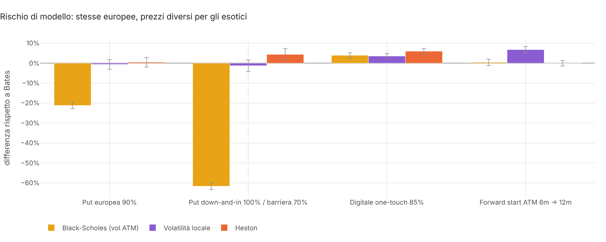
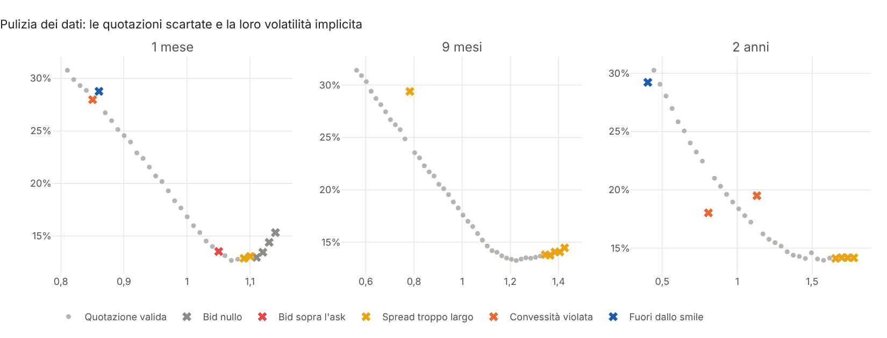
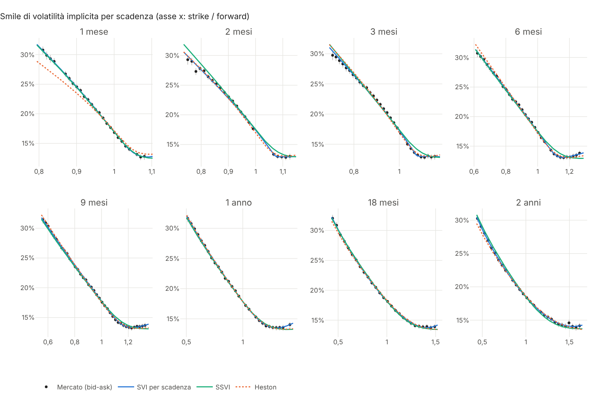
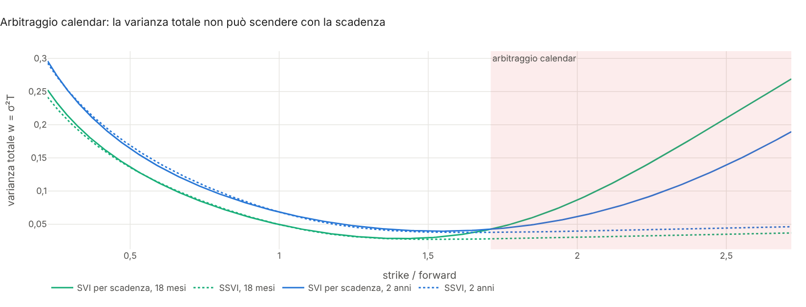
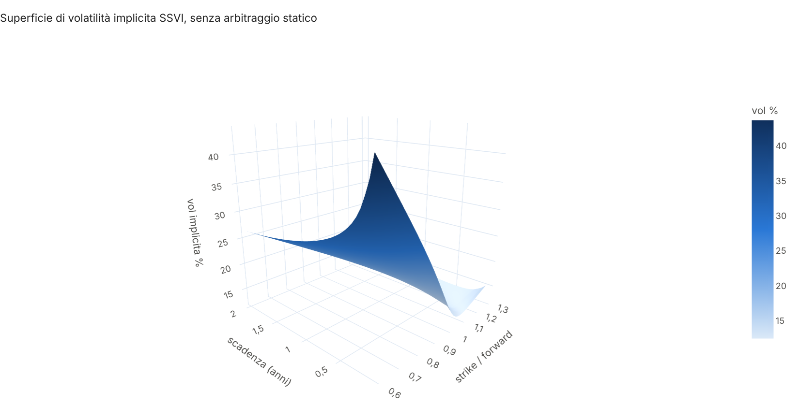
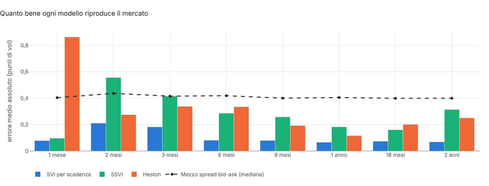
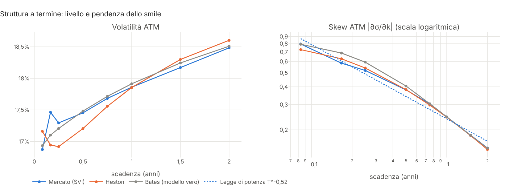

# Vol Surface Lab

**La superficie di volatilità implicita di un indice azionario, costruita come in un desk di derivati, in Python:
forward e sconto dalla parità put-call, pulizia dei dati di fine giornata, smile SVI per scadenza, superficie SSVI
senza arbitraggio, calibrazione del modello di Heston, volatilità locale di Dupire e prezzi di prodotti esotici sotto
modelli diversi, per misurare il rischio di modello.**

Dentro ogni certificato con barriera c'è un'opzione esotica che l'investitore vende all'emittente. Il suo prezzo
dipende dal modello di volatilità, e modelli che danno lo stesso prezzo alle opzioni europee possono dare prezzi
molto diversi agli esotici. Il progetto parte da una catena di opzioni grezza, con i suoi errori, e risponde alle
domande di chi gestisce o valuta derivati: **quali quotazioni sono affidabili? Che forma ha lo smile e come cambia con
la scadenza? La superficie ammette arbitraggi? Quanto bene un modello a volatilità stocastica riproduce il mercato, e
dove sbaglia? Quanto vale una put con barriera secondo modelli diversi, e quanto costa usare il modello sbagliato?** Il
risultato è un **report HTML interattivo**.



## Cosa fa

| Area | Contenuto |
|---|---|
| **Black sul forward** | Prezzi, delta, gamma e vega; volatilità implicita con il metodo di Brent e controllo dei limiti di arbitraggio |
| **Forward e sconto** | Regressione robusta della parità put-call `C − P = D·(F − K)` sugli strike vicini allo spot: tasso e carry impliciti senza ipotesi sui dividendi |
| **Pulizia dei dati** | Bid nullo, bid sopra l'ask, spread troppo largo, prezzo fuori dai limiti di arbitraggio, **convessità** del prezzo rispetto allo strike (butterfly negativo oltre lo spread), quotazioni lontane dallo smile oltre due mezzi spread |
| **SVI** | Smile per scadenza con la SVI raw di Gatheral, minimi quadrati pesati con lo spread e più punti di partenza |
| **Arbitraggio statico** | Funzione g(k) di Durrleman (densità neutrale al rischio positiva) e controllo calendar (varianza totale crescente con la scadenza) |
| **SSVI** | Superficie di Gatheral e Jacquier con φ a legge di potenza e il vincolo η(1 + \|ρ\|) ≤ 2: senza arbitraggio statico per costruzione |
| **Heston e Bates** | Funzione caratteristica nella forma «little trap» di Albrecher, prezzi con la formula di Lewis e quadratura di Gauss-Legendre, salti di Merton per Bates; calibrazione sugli errori in volatilità; Monte Carlo con Eulero «full truncation» |
| **Struttura a termine** | Volatilità ATM e pendenza dello smile per scadenza, legge di potenza dello skew |
| **Volatilità locale** | Formula di Dupire nella forma di Gatheral, σ²(k, T) = (∂w/∂T) / g(k), sulla superficie SSVI; Monte Carlo con volatilità locale |
| **Esotici** | Put down-and-in (quella dei certificati Bonus e Cash Collect), digitale one-touch, forward start: prezzi con Black-Scholes, volatilità locale, Heston e il modello vero |
| **Dati** | Mercato sintetico generato da un modello di Bates, con bid-ask realistici e 14 errori di dati inseriti di proposito; lettura di catene reali da CSV |
| **Report** | HTML in italiano con 9 grafici interattivi Plotly, tra cui la superficie 3D |

Tutti i modelli sono scritti da zero su `numpy` e `scipy`, così ogni formula è leggibile e verificabile. Grafici
`plotly`, report `jinja2`.

## Avvio rapido

```bash
git clone https://github.com/Torraf-MI/vol-surface-lab.git
cd vol-surface-lab
pip install -e ".[png]"

# Report del mercato dimostrativo (circa 15 secondi con 40.000 percorsi Monte Carlo)
vol-surface-lab --demo

# Senza il Monte Carlo degli esotici
vol-surface-lab --demo --veloce

# Una catena di opzioni da CSV (scadenza, strike, tipo, bid, ask), con i grafici anche in PNG
vol-surface-lab --csv esempi/catena_sintetica.csv --spot 5000 --grafici output/img

# Un mercato descritto in JSON; report utilizzabile senza rete
vol-surface-lab --config esempi/indice_sintetico.json --offline
```

Il report viene salvato in `output/report.html`. Un esempio già generato:
[`docs/report_esempio.html`](docs/report_esempio.html).

Il CSV ha una riga per opzione; la scadenza può essere una data (con `--data` per la data di valutazione) o in anni:

```csv
scadenza,strike,tipo,bid,ask
2026-12-18,4800,P,61.2,63.0
2026-12-18,5200,C,44.8,46.5
```

## Uso come libreria

```python
import numpy as np
from vol_surface_lab import Heston, Salti, analizza, esempio, prezzo_europeo, vol_implicita

h = Heston(kappa=1.6, theta=0.04, xi=0.6, rho=-0.7, v0=0.025)
prezzo_europeo(5000, np.array([4000.0, 4500.0]), 1 / 12, h, call=False)                         # Heston
prezzo_europeo(5000, np.array([4000.0, 4500.0]), 1 / 12, h, call=False, salti=Salti(0.5, -0.1, 0.08))  # Bates

a = analizza(esempio())
a.errori          # errore per scadenza di SVI, SSVI e Heston, in punti di volatilità
a.controlli       # arbitraggi butterfly e calendar
a.calibrazione    # parametri di Heston
a.esotici         # prezzi degli esotici per modello
```

Esempio completo in [`examples/esempio.py`](examples/esempio.py).

## Risultati sull'esempio dimostrativo

Il mercato è un indice azionario europeo sintetico a 5.000 punti, con tasso del 2,5% e dividendi del 3%. I prezzi
veri vengono da un modello di **Bates**: Heston con salti al ribasso in media del 10%, uno ogni due anni. Il progetto
non lo sa: vede solo 564 quotazioni bid-ask di call e put su otto scadenze, da un mese a due anni, con quattordici
errori inseriti di proposito. Conoscere il modello vero permette di misurare quanto sbaglia ciascun metodo, cosa che
con i dati reali non si può fare.

**Il forward si legge nei prezzi.** La parità put-call ritrova forward e fattori di sconto con un errore massimo
dello 0,01% sul forward e un tasso implicito tra il 2,2% e il 2,6% (vero: 2,5%). Il carry implicito, tasso meno
dividendi, è intorno a −0,50% su tutte le scadenze (vero: −0,50%).

**Un quinto delle quotazioni va scartato.** Delle 282 opzioni fuori dal denaro ne restano 230. Le altre sono soprattutto
quotazioni lontane dal denaro con spread troppo larghi (29) o bid nullo (8), più gli errori. I tre bid sopra l'ask e i tre spread
anomali sono presi tutti; delle otto quotazioni vecchie, sei sono individuate dal controllo di convessità o dallo
smile; le due che restano sono dentro il rumore. I falsi allarmi sono tre su 230 quotazioni buone.



**La SVI per scadenza riproduce il mercato dentro lo spread, ma ha arbitraggi.** L'errore medio è di 0,11 punti di
volatilità, contro un mezzo spread di 0,41, e il 98% dei prezzi cade dentro il bid-ask. Fuori dagli strike quotati però
le SVI stimate una per una si incrociano: tra 18 mesi e 2 anni la varianza totale scende con la scadenza (arbitraggio
calendar) e a 18 mesi la densità diventa negativa (butterfly). Sono zone che i dati non coprono, ma in cui un Monte
Carlo per un esotico finisce comunque.





**La SSVI non ha arbitraggi, e lo paga in precisione.** Con tre parametri (ρ = −0,67, η = 0,80, γ = 0,47) e la
condizione η(1 + |ρ|) = 1,33 ≤ 2, la superficie è senza arbitraggio statico a ogni strike e scadenza. L'errore medio
sale a 0,28 punti di volatilità e l'81% dei prezzi resta dentro lo spread. È la superficie usata per la volatilità
locale.



**Heston va bene dai due mesi in su, non sul primo mese.** I cinque parametri (κ = 3,44, θ = 0,044, ξ = 0,76,
ρ = −0,72, v₀ = 0,031, con la condizione di Feller violata come quasi sempre sugli indici) danno un errore di 0,12
punti a un anno e sempre sotto il mezzo spread dai due mesi in su, ma di 0,86 punti a un mese, più del doppio del
mezzo spread. Lo smile a un mese è ripido per il
rischio di salti, che un modello a volatilità continua non ha: per inseguirlo Heston dovrebbe alzare la volatilità
della varianza e guasterebbe le scadenze lunghe.



**La pendenza dello smile scende come T^−0,52.** Da −0,80 a un mese a −0,15 a due anni (∂σ/∂k al forward): una legge
di potenza che il mercato reale mostra con esponenti simili. La volatilità locale è circa 1,7 volte più inclinata di
quella implicita vicino al denaro, vicino alla regola del «doppio dello skew».



**Gli esotici: stesse europee, prezzi diversi.** Prezzi a un anno in percentuale del nozionale, 40.000 percorsi con
osservazione giornaliera (errore standard tra 0,03 e 0,24 punti):

| Prodotto | Black-Scholes (vol ATM) | Volatilità locale | Heston | Bates (vero) |
|---|---|---|---|---|
| Put europea 90% (mercato: 3,71%) | 2,92% | 3,69% | 3,73% | 3,71% |
| **Put down-and-in 100%, barriera 70%** | **1,54%** | **3,97%** | **4,20%** | **4,02%** |
| Digitale one-touch 85% | 37,26% | 37,12% | 37,99% | 35,85% |
| Forward start ATM 6 → 12 mesi | 4,78% | 5,08% | 4,76% | 4,76% |

- **Black-Scholes con una sola volatilità sottovaluta la put con barriera del 62%.** Ignora che le volatilità salgono
  proprio quando l'indice scende verso la barriera. Un investitore che valuta il proprio certificato così pensa di
  vendere un'opzione da 1,5 punti; ne vale 4.
- **Volatilità locale e Heston prezzano le europee allo stesso modo ma la barriera con 0,23 punti di differenza** (il
  6%): la prima sta sotto il prezzo vero, la seconda sopra.
- **Sulla digitale sbagliano tutti nella stessa direzione**, del 3,5-6%: senza salti un indice che scende deve passare
  dalla barriera, con i salti può saltarla. Sulla forward start la volatilità locale è l'unica fuori (+7%), perché
  prevede uno smile futuro diverso da quello di oggi.

## Metodologia in breve

- **Mercato sintetico**: Bates con κ = 1,6, θ = 0,04, ξ = 0,6, ρ = −0,7, v₀ = 0,025 e salti lognormali con
  intensità 0,5, media −10% e deviazione 8%. Strike ogni 25-100 punti tra circa −3 e +2 deviazioni standard; mezzo
  spread pari alla vega per 0,3 punti di volatilità più una parte che cresce con la distanza dal denaro; rumore sul mid
  pari a un quarto del mezzo spread; tick di 0,1. Errori: otto quotazioni spostate del 20-40%, tre bid sopra l'ask,
  tre spread anomali.
- **Parità put-call**: regressione sugli strike entro il 25% dallo spot, togliendo uno alla volta i residui oltre tre
  deviazioni assolute mediane.
- **Pulizia**: opzioni OTM; spread relativo massimo del 60%; butterfly sulle call equivalenti con tolleranza pari agli
  spread delle tre gambe, eliminando il punto che riduce di più la violazione; SVI ripetuta togliendo la quotazione più
  lontana oltre due mezzi spread in volatilità (minimo 0,6 punti).
- **Calibrazioni**: SVI su w = σ²T con pesi 1/(2σT · mezzo spread); SSVI con θ(T) dalle SVI (resa crescente) e
  interpolazione monotona; Heston sui residui prezzo/vega pesati con la radice dell'inverso dello spread, con
  `scipy.optimize.least_squares`.
- **Esotici**: tasso e carry impliciti dalla parità; 252 passi l'anno e variabili antitetiche; la put di confronto usa
  la volatilità della superficie SSVI al suo strike.

## Struttura

```
src/vol_surface_lab/
├── black.py              # Black sul forward, greche, volatilità implicita
├── heston.py             # Heston e Bates: funzione caratteristica, Lewis, calibrazione, Monte Carlo
├── svi.py                # SVI, SSVI, densità, controlli butterfly e calendar
├── volatilita_locale.py  # Dupire dalla SSVI e Monte Carlo
├── mercato.py            # catena sintetica, CSV, parità put-call, pulizia
├── esotici.py            # payoff e prezzi Monte Carlo
├── configurazione.py     # caso dimostrativo e JSON
├── analisi.py            # la pipeline completa
├── report.py             # grafici Plotly e report HTML
├── cli.py                # riga di comando
└── templates/            # modello del report
esempi/                   # il mercato dimostrativo in JSON e la catena in CSV
examples/                 # uso come libreria
tests/                    # 42 test (pytest), eseguiti a ogni push con GitHub Actions
```

## Test

```bash
pip install -e ".[dev]"
pytest
```

I test confrontano ogni metodo con un risultato noto. Black: parità put-call, inversione della volatilità implicita,
limiti di arbitraggio, vega contro le differenze finite. Heston: la funzione caratteristica è una martingala, senza
volatilità della varianza ritrova Black, senza salti Bates è Heston, parità put-call, salti negativi che rincarano le
put lontane, Monte Carlo coerente con la formula chiusa (con e senza salti), calibrazione che ritrova i parametri da
prezzi generati. SVI e SSVI: parametri ritrovati, g = 1 con volatilità piatta, densità che integra a uno con il forward
come martingala, l'esempio con arbitraggio butterfly di Vogt individuato, arbitraggio calendar individuato, SSVI senza
arbitraggi sotto il vincolo. Volatilità locale: piatta se la superficie è piatta, Monte Carlo che riprezza le europee,
più ripida della implicita. Mercato: forward e sconto ritrovati, errori evidenti scartati, lettura da CSV. Esotici:
barriera «in» più «out» uguale alla put, one-touch contro la formula chiusa con la correzione di Broadie, Glasserman e
Kou, forward start contro Black. Sul caso dimostrativo: SVI dentro lo spread, Heston peggiore sul primo mese, SSVI senza
arbitraggi, skew decrescente, Black-Scholes che sottovaluta la barriera; JSON, report e riga di comando dall'inizio
alla fine.

## Avvertenze

I dati sono sintetici: nessun prezzo reale di mercato. Il modello del mercato (Bates) è una scelta; i mercati reali
hanno dividendi discreti, scadenze con calendari precisi, spread e liquidità variabili. Non sono considerati i
dividendi discreti, l'esercizio anticipato delle opzioni americane, il rischio di controparte e i costi di copertura.
La volatilità locale è stimata sulla superficie SSVI, che non riprezza esattamente ogni quotazione. Il progetto ha scopo
dimostrativo e non costituisce consulenza finanziaria né raccomandazione di investimento.

## Licenza

MIT. Autore: Francesco Torraco.
